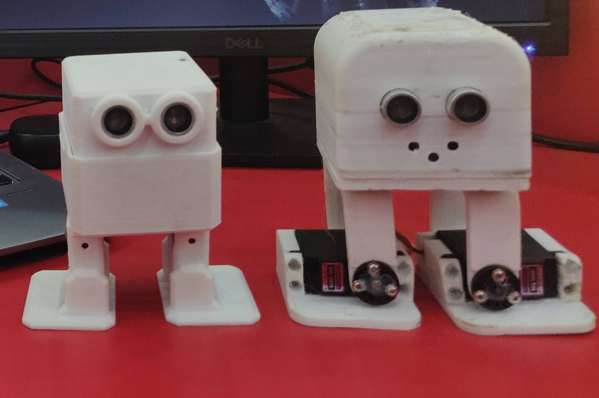
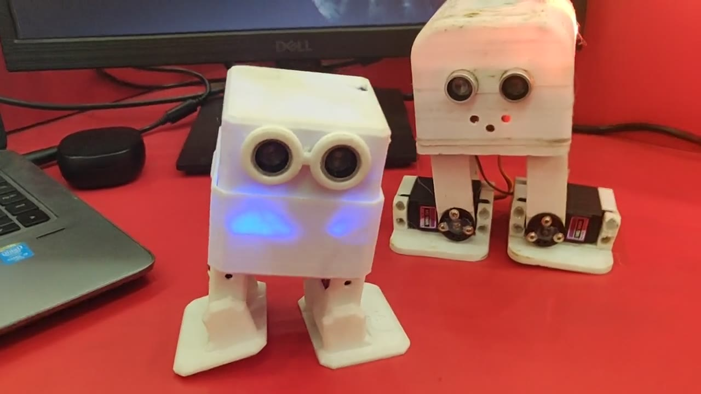
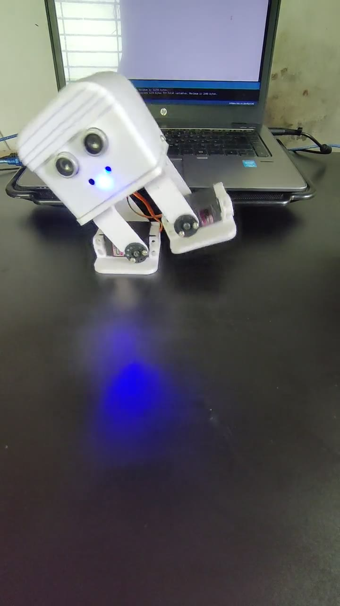

# Teslon

An Arduino library and example sketches for Teslon, my two small walking
robots of 2022, built on the open-source Otto DIY design. The library is
the [OttoDIY library](https://github.com/OttoDIY/OttoDIYLib), renamed and
trimmed; the example sketches are mine, adapted from OttoDIY's examples.

| | |
|---|---|
|  **2022-05-23:** the two robots moving side by side ([video](docs/media/teslon-2022-05-23-two-robots-moving.mp4), 25 s) |  **2022-06-02:** a touch on its head starts its next move ([video](docs/media/teslon-2022-06-02-hand-reaction.mp4), 8 s) |

## What it does

Each Teslon walks on two legs, with a servo at each hip and each ankle, as
in Otto. The library, in [`src/`](src), moves the four servos, mostly as
smooth oscillations, and plays sounds on a buzzer: walking, turning,
bending, moonwalking, swinging and more, and 19 short songs.

The three examples, in [`examples/`](examples), are mine, adapted from
OttoDIY's:

| Example | What it does |
|---|---|
| [`teslonAvoidObstacle`](examples/teslonAvoidObstacle) | Walks forward; when the ultrasonic sensor sees something within 7 cm, it turns the LED red, makes a sound, backs up and turns, left and right in turn |
| [`teslonTouch`](examples/teslonTouch) | A touch steps it to the next of 14 modes of moves and songs (a held touch can skip modes) |
| [`teslonAllMoves`](examples/teslonAllMoves) | Loops through 12 of the library's 13 moves (all but jump) and 18 of its 19 songs, lighting the LED green, red and blue for the walks and turns |

## How it works

| | |
|---|---|
| Board | An Arduino Nano |
| Servos | Left hip D2, right hip D3, left ankle D4, right ankle D5; their trims are read from EEPROM |
| Senses | An ultrasonic sensor, HC-SR04 type (trigger D9, echo D8) and a touch sensor (D6) |
| Shows | An RGB LED (D10, D11, D12, lit by driving the pin low) and a buzzer (D7) |

## Install it

Copy this repository into your Arduino `libraries/` folder, or add it as a
.zip library in the Arduino IDE, then open an example from
File > Examples > teslon (under Examples from Custom Libraries). Don't use
it in the same sketch as the OttoDIY library: both have an `Oscillator`
class in `Oscillator.h`.

The code keeps OttoDIY's switch to the ESP32 servo library, but the robots
ran on an Arduino Nano, and the ESP32 path was not tried: its EEPROM is
never started, so the servo trims won't load there.

## Credits

- The library in `src/` is the
  [OttoDIY library](https://github.com/OttoDIY/OttoDIYLib) by Otto DIY and
  Camilo Parra Palacio, renamed from Otto to teslon, with its LED matrix,
  mouth and gesture code taken out.
- Its `Oscillator` code is by Juan Gonzalez-Gomez (Obijuan), 2011.
- The examples follow the OttoDIY library's examples; their buzzer,
  sensor and LED pins, RGB LED, 7 cm threshold and touch modes are mine.

## Licence

GPL-3.0, as the OttoDIY library it comes from: see [LICENSE](LICENSE).
